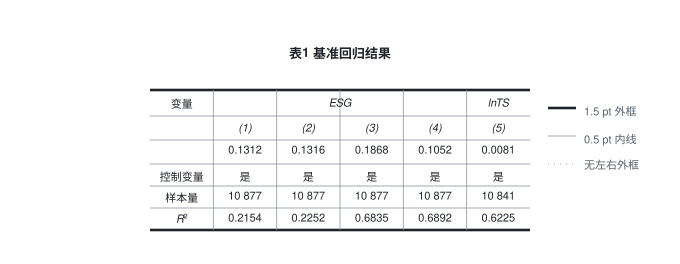

# 学术回归结果表版式 · 全网格三线表变体

一套可直接复用的**回归结果表（regression table）版式规范 + 生成脚本**。
用 Python 一条命令生成符合国内经管类论文排版习惯的 `.docx` 表格，也可以照规范在 Word 里手工复现。



## 这套版式长什么样

- **边框**：上下各一条 1.5 pt 粗线封边，内部横竖线统一 0.5 pt 细网格，**左右两端没有外框**
- **列宽**：6 列等宽 2.53 cm，全表 15.19 cm，与 A4 版心（15.2 cm）齐平
- **字号**：表体 9 pt（小五）、表题 10.5 pt（五号）加粗居中
- **字体**：中文宋体 + 西文 Times New Roman
- **表头**：两行——第一行是"变量 / 被解释变量分组"，第二行是模型编号 (1)–(5)
- **合并**：`变量` 纵向合并两行，`ESG` 横跨 (1)–(4)，`lnTS` 占第 (5) 列
- **系数与标准误**：同一个单元格内上下两段，靠"段前 1 pt / 段后 1 pt"收成一组
- **斜体规则**：变量名与 `R` 斜体，`×`、数字、括号、`ln` 一律正体；星号为上标

## 快速开始

```bash
pip install python-docx
python src/make_reg_table.py            # 生成 regression_table.docx
python src/make_reg_table.py --out 表2.docx
```

## 换成你自己的数据

只改 `src/make_reg_table.py` 顶部的数据块，版式常量不用碰：

```python
EXAMPLE = {
    "title": "表2  稳健性检验",
    "groups": [("ESG", 3)],                    # 被解释变量：名称 + 占几列
    "rows": [
        {"label": "CBEC×Post", "italic": True, "align": "left",
         "cells": [("0.2043", "**", "(0.0912)"),
                   ("0.1975", "**", "(0.0880)"),
                   ("0.2110", "***", "(0.0741)")]},
        {"label": "控制变量",   "cells": ["是", "是", "是"]},
        {"label": "年份固定效应", "cells": ["是", "是", "是"]},
        {"label": "样本量",     "cells": ["8 421", "8 421", "7 903"]},
        {"label": "R2",        "cells": ["0.3321", "0.3408", "0.3512"]},
    ],
    "note": "分别表示在 10%、5%、1% 的水平上显著，括号内为聚类稳健标准误。",
}
```

也可以当库调用：

```python
from make_reg_table import build
build(my_spec, "out.docx")
```

列数由 `groups` 自动推导，不需要手动加列。

## 目录结构

```
.
├── docs/
│   ├── format-spec.md      # 完整版式规范（实测参数，含手工复现步骤）
│   └── preview.svg         # 版式预览图
├── examples/
│   └── example_regression_table.docx   # 用示例数据生成好的成品
└── src/
    └── make_reg_table.py   # 生成脚本（数据与版式常量分离）
```

## 复用时的三个坑

1. **表头下方那条线其实没有加粗**。本版式所有内部横线都是 0.5 pt，表头两行下方那两条和数据行一样细。
   若想"表头下线也粗"，必须单独给表头行设 1.5 pt 下框线。
2. **左右没有外框**。竖线只在列间，表格左右是开放的。要四边闭合，补 `left` / `right` 1.5 pt。
3. **第 1 列处于宽度临界点**。2.53 cm 减去左右内边距 0.38 cm 只剩 2.15 cm，
   "企业固定效应"六个汉字 9 pt 约 1.9 cm，刚好放得下；标签再长两字就会折行，
   届时把第 1 列加宽到 3.0–3.5 cm、相应压窄数据列。

## 实现要点

- OOXML 的 `w:sz` 单位是 **1/8 磅**：1.5 pt = 12，0.5 pt = 4。
- `tblBorders` / `tcBorders` / `vAlign` 等子元素**必须按 schema 顺序插入**，顺序错了 Word 会提示"内容有问题"。
- 纵向合并单元格的边框要设在合并区域的**最后一格**才生效，设在起始格会被忽略。
- 表格同时设置 `tblLayout=fixed` 与逐列 `tcW`，列宽才不会被内容撑变。

完整参数见 [docs/format-spec.md](docs/format-spec.md)。

## License

MIT
